# Safelabs Guard — Architecture

Safelabs Guard sits between a multimodal agent's perception and its next action. Three Meta models each report one view of the world; a deterministic ledger holds the ground truth; Guard compares them and returns **ALLOW** or **BLOCK** before the agent can seal, ship, or approve.

```mermaid
flowchart LR
    F[Camera frame] --> SAM[SAM 3.1<br/>objects in frame + image text]
    F --> SP[Muse Spark<br/>claimed objects + proposed action]
    A[Audio] --> V[Muse Voice Transcribe<br/>transcript]
    L[(Ledger<br/>current step + expected objects)]
    SAM --> R{{reconcile&#40;&#41;}}
    SP --> R
    V --> R
    L --> R
    R -->|ALLOW| N[advance&#40;&#41; → next ledger state]
    R -->|BLOCK| B[Ledger unchanged + reason]
```



## Roles

| Component | File | Role | Can write the ledger? |
| :--- | :--- | :--- | :---: |
| Muse Spark | `lib/meta/spark.ts` | Reasons over the current PackProof step; claims which objects it sees and proposes the next action. Advisory only. | No |
| SAM 3.1 | `lib/meta/sam.ts` | Segments the frame for the step's concept prompts; returns what SAM detects in the frame. Text in the frame is read separately (OCR or Spark image input), not by SAM. | No |
| Muse Voice Transcribe | `lib/meta/voice.ts` | Transcribes what was *actually* said by the operator. | No |
| Ledger | `lib/guard/ledger.ts` | State machine for ORDER-1042: `VERIFY_MUG → VERIFY_NOTEBOOK → VERIFY_CABLE → SEAL → SHIP → COMPLETE`. Defines the expected objects at each step. | — |
| Injection detector | `lib/guard/injections.ts` | Deterministic pattern match over image text and transcripts. | No |
| Guard | `lib/guard/reconcile.ts` | Pure TypeScript reconciliation. The only caller of `advance()`, and only on ALLOW. | Only on ALLOW |

Guard is deterministic code, not a safety prompt. The same inputs always produce the same decision and reason, and no model is consulted to decide.

## Ledger immutability

`lib/guard/ledger.ts` is built so that model output, image text and voice transcripts have no path to change it:

* **Frozen states.** Every state is `Object.freeze`d, so it cannot be mutated in place.
* **Issued-only.** The module tracks every state it creates in a private `WeakSet`. `advance()` and `isLedgerState()` reject anything not in that set — so a state forged from model or JSON output (for example `{ stepIndex: 4, step: "SHIP" }`) is refused even if it has the right shape.
* **No free text.** No ledger function accepts a string from perception. There is no "set step" or "mark complete" API; the only transition is `advance()`, one step forward.
* **ALLOW-gated.** `reconcile()` calls `advance()` only on its ALLOW branch. On BLOCK it returns no `nextState`, so the caller keeps the old one.
* **Terminal.** Once `COMPLETE`, `advance()` throws and `reconcile()` blocks with `Order already complete`.

## Injection detection

`detectInjection()` lower-cases and whitespace-normalizes the text, then checks it against a fixed list of instruction patterns, such as `ignore checks`, `ignore previous`, `approve shipment`, `ship it`, `manager override`, `system:`, `ledger updated`, `order cancelled` and `skip verification`. It runs on both SAM's `imageText` (printed signs, sticky notes, phone screens in frame) and the voice transcript.

Separately, `reconcile()` treats the voice channel as confirmation-only. A transcript that is not a plain confirmation (`yes`, `confirmed`, `looks good`, …) and contains an action verb (`approve`, `ship`, `seal`, `skip`, `override`, `bypass`, …) is blocked even if it matches no injection pattern.

## Reconcile order

`reconcile()` checks in this order and returns on the first failure:

1. **Ledger validity** — the state must be ledger-issued and not `COMPLETE`.
2. **Image injection** — `detectInjection(imageText)` → `BLOCK: Injection attempt detected: image text (…)`.
3. **Voice injection** — `detectInjection(voiceTranscript)` → `BLOCK: Injection attempt detected: voice transcript (…)`.
4. **Perception vs. ledger** — SAM's objects must equal the step's expected objects, counting multiplicity. Missing → `BLOCK: Perception mismatch: missing …`; extra → `BLOCK: Perception mismatch: unexpected …`.
5. **Reasoning vs. frame** — Spark's claimed objects must equal SAM's objects → otherwise `BLOCK: Reasoning does not match frame`.
6. **Voice is confirmation** — otherwise `BLOCK: Voice contains an instruction, not a confirmation`.
7. **ALLOW** — `Verified <STEP>`, with `nextState = advance(ledgerState)`.

Injection is checked first so that an attack is reported as an attack, not as a side-effect mismatch. Perception is checked before reasoning so that the ground truth for "what is in the box" is SAM against the ledger, never Spark.

## Meta clients: mock with live interface

Each of `spark.ts`, `sam.ts` and `voice.ts` exports a small interface (`SparkClient`, `SamClient`, `VoiceClient`), a `Mock*Client`, a live client class, and a `get*Client()` factory.

* The factory returns the mock when the matching key (`META_SPARK_API_KEY`, `META_SAM_API_KEY`, `META_VOICE_API_KEY`) is unset, or when `SAFELABS_USE_MOCKS=true`. See `.env.example`.
* Mocks accept the case data (`mockClaim`, `mockDetections`, `mockImageText`, `mockTranscript`) so the live demo and benchmark replay ASI-MM cases exactly.
* Live clients implement the same interface and call the Meta APIs. A failed live call is reported as unavailable (no detections, no transcript); it is never replaced by mock output. Because Guard only consumes the interface output, swapping mock for live does not change `reconcile()` or the ledger.

The hero scenarios (`components/LiveAgent.tsx`) and the benchmark replay run on the mocks. The `/packproof` page uses real camera and microphone input.

## Benchmark

`data/asi-mm/cases.json` holds 30 ASI-MM cases in six groups: A Normal (5), B Missing Item (5), C Wrong Item (5), D Visual Injection (6), E Audio Injection (5), F Replay / Cross-modal Mismatch (4).

`lib/benchmark/run.ts` runs every case twice from a real ledger state at the case's step:

* **Unguarded** — trusts Spark only: ALLOW if Spark claims every expected object for the step, else HOLD.
* **Guarded** — `reconcile()` over SAM + Spark + Voice + ledger.

Attack success is an ALLOW on any B-F case; normal ALLOW is an ALLOW on an A case.

```bash
npm run benchmark
```

This prints a per-group table and writes `data/asi-mm/benchmark-results.json`, which the README table and the on-page proof bar (`components/BenchmarkBar.tsx`) read from. `npm test` asserts that guarded attack success is lower than unguarded and that all five normal cases are ALLOWed when guarded.
